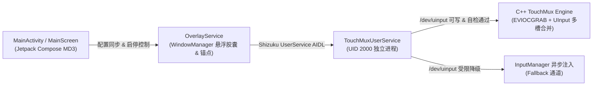

# 零断触连点器 (ZeroInterruptClicker)

面向 Android 手游与平板多指交互场景设计的 **硬件级零断触自动化连点工具**。基于 **Shizuku 特权服务 + Native C++ `TouchMux` (`/dev/uinput` 多点触控硬件合流)** 架构，结合 **Material Design 3（Material You 动态取色 + 日夜自适应）** 主界面与**三态可折叠贴边悬浮胶囊**，实现左手摇杆持续移动、右手视野滑动与自动连点并发注入互不打断。

> [!NOTE]
> 本项目仅使用标准 Android Accessibility 无关的 Shizuku 跨进程输入合流方案，核心输入合并由 C++ Native 层在 `/dev/input` 与 `/dev/uinput` 节点之间完成；在 `/dev/uinput` 受 SELinux 策略限制的设备上会自动降级为 Shizuku `InputManager` 异步注入通道。

---

## 核心特性

| 模块 | 核心能力 | 实现机制 |
| :--- | :--- | :--- |
| **硬件级四层零断触注入** | 物理触屏事件与连点锚点事件在虚拟设备硬件层面合并上报，互不抢占 `MotionEvent` 流 | Tier 1 `/dev/uinput` → Tier 2 `/dev/uhid`（10 指固定槽位映射）→ Tier 3 Hybrid → Tier 4 `InputManager` |
| **5 秒安全自检回滚** | 开启硬件接管前强制 5 秒确认保护；超时或长按音量减 3 秒立即释放 `EVIOCGRAB` | Shizuku UID 2000 守护定时器 + 主界面实时倒计时弹窗 |
| **高精度连招录制 & 编译** | 0.75px / 4ms (~250Hz) 物理触控采样，3D 时空道格拉斯-普克简化与不断触衔接合并 | `TouchMuxEngine::recordLoop` + `MacroCompiler` + 顺序连招整套遍数 (`presetLoopCount`) |
| **树形方案管理 & 冻结** | 录制子方案默认冻结并挂于大方案树下（如 `3.1`），默认收起、不占序号、删主删子 | `ClickConfigStore` JSON 持久化 + `PresetTreeFreezeDialog` 树形冻结解冻 |
| **自由悬停三态悬浮胶囊** | 展开态可自由悬停屏幕任意位置，也可随时贴边收起为 `20dp × 80dp` 迷你边栏 | `ControlBarView` 三态视图 + `OverlayService` 零重排状态刷新 |
| **经典涟漪触控反馈** | 悬浮胶囊按钮、端盖、微调面板及未锁定锚点全面配备经典水波纹点按反馈 | 原生 `RippleDrawable` + Compose Material 3 Ripple |

---

## 工作架构



---

## 悬浮控制胶囊交互说明

- **初始精简形态**：支持拖动悬停在屏幕任意位置，显示 **顶部贴边按钮（`<` / `>`）**、**开始/停止连点（▶ / ■）**、**一键切换方案（按未冻结方案编号 `1..N`）** 与 **底部工具展开按钮（`∨`）**。
- **工具展开形态**：点击底部 `∨` 向下展开 `+`（添加锚点）、`-`（删除选中锚点）、`🔒`（锁定穿透 / 解锁拖动）、`⚙`（单点微调面板）、`●`（连招录制）、`✕`（退出悬浮窗）；再点 `∧` 折回精简态。
- **贴边迷你胶囊**：点击顶部 `<` / `>`、或开启「启动后贴边收起」后自动靠边并缩为 `20dp × 80dp` 小胶囊，支持拖过屏幕中线自动换边停靠。
- **顺序连招整套遍数**：在方案页切换为「顺序」模式后可配置 `整套执行遍数`（`0` 为无限循环，`>= 1` 跑完指定遍数后自动停止并重置状态）。

---

## 环境要求与构建方法

### 运行环境
- **系统版本**：Android 8.0 及以上（`minSdk = 26`，`targetSdk = 35`），推荐 Android 12+ 以体验完整 Material You 动态取色。
- **前置权限与建议配置**：
  1. 悬浮窗显示权限（`SYSTEM_ALERT_WINDOW`）；
  2. 已安装并激活 **Shizuku**（无线调试 / ADB 模式或 Root 模式均可），并对本应用授权；
     - 在本应用的 Shizuku 连接卡片点击「授权连接」，并在 Shizuku 管理器弹窗中允许本应用；授权通过 Shizuku API 请求和结果回调处理，不需要在 Android 系统设置中单独申请 API_V23 运行时权限；
     - 若连接卡片长时间停留在「连接中」，请点按卡片上的「重新连接」——应用会向 Shizuku 服务端申请**全新**的 UserService 进程（版本号自增，服务端会销毁旧进程后重建），从而摆脱残留的失效绑定；
  3. Android 13+ 建议开启通知权限（`POST_NOTIFICATIONS`）以稳定显示前台服务通知；
  4. 建议忽略电池优化（`REQUEST_IGNORE_BATTERY_OPTIMIZATIONS`）设为「无限制」，避免后台保活与定时触发被系统省电策略限制。

### 本地源码编译
- **构建工具链**：JDK 17、Gradle `9.3.1`、AGP `9.1.0`、NDK `28.2.13676358`（`arm64-v8a` / `x86_64`）。
- 克隆仓库并在 `local.properties` 配置本地 `sdk.dir` 后执行：

```bash
# 编译 Debug 与 Release APK
./gradlew :app:assembleDebug :app:assembleRelease
```

---

## 免责声明

本项目仅供个人安卓技术研究、输入子系统学习与无障碍辅助场景使用，请遵守各应用与游戏的用户协议及当地法律法规。
