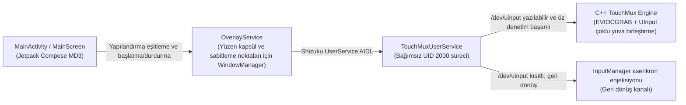

# Kesintisiz Otomatik Tıklayıcı (ZeroInterruptClicker)

Android oyunlarında ve tabletlerde çok parmaklı etkileşim için tasarlanmış **donanım düzeyinde, dokunma kesintisi oluşturmayan otomatik tıklama aracı**. **Shizuku ayrıcalıklı hizmeti + yerel C++ `TouchMux` (`/dev/uinput` üzerinden çoklu dokunma olaylarını donanım düzeyinde birleştirme)** mimarisini; **Material Design 3 (Material You dinamik renkleri ve gündüz/gece uyarlaması)** arayüzü ve **üç durumlu, katlanabilir, kenara yanaşabilen yüzen kapsülle** bir araya getirir. Böylece sol elle joystick'i hareket ettirirken sağ elle kamera görünümünü kaydırmak ve otomatik tıklamaları aynı anda çalıştırmak birbirini kesintiye uğratmaz.

> [!NOTE]
> Bu proje, Android Accessibility hizmetlerini kullanmaz; bunun yerine Shizuku üzerinden süreçler arası giriş birleştirmesi yapar. Giriş olaylarının birleştirilmesi C++ yerel katmanında `/dev/input` ve `/dev/uinput` aygıt düğümleri arasında gerçekleştirilir. `/dev/uinput` erişiminin SELinux politikalarıyla kısıtlandığı cihazlarda sistem, Shizuku `InputManager` asenkron giriş enjeksiyonu kanalına otomatik olarak geçer.

---

## Öne çıkan özellikler

| Modül | Temel özellik | Uygulama yöntemi |
| :--- | :--- | :--- |
| **Donanım düzeyinde dört katmanlı kesintisiz giriş enjeksiyonu** | Fiziksel dokunmatik ekran olayları ile otomatik tıklama sabitleme noktalarının olayları sanal aygıtın donanım katmanında birleştirilerek bildirilir; `MotionEvent` akışları birbirini engellemez. | Katman 1 `/dev/uinput` → Katman 2 `/dev/uhid` (10 parmak için sabit yuva eşlemesi) → Katman 3 Hybrid → Katman 4 `InputManager` |
| **5 saniyelik güvenlik denetimi ve geri alma** | Donanım denetimi devralınmadan önce 5 saniyelik zorunlu onay koruması uygulanır. Süre aşımında veya ses kısma tuşuna 3 saniye basıldığında `EVIOCGRAB` hemen serbest bırakılır. | Shizuku UID 2000 zamanlayıcısı ve ana ekranda canlı geri sayım penceresi |
| **Hassas makro kaydı ve derleme** | Fiziksel dokunuşlar 0,75 px / 4 ms (~250 Hz) hassasiyetle örneklenir; 3B uzay-zaman Douglas–Peucker sadeleştirmesi ve dokunma kesintisi olmadan ardışık tutuşları birleştirme uygulanır. | `TouchMuxEngine::recordLoop` + `MacroCompiler` + ardışık makronun toplam döngü sayısı (`presetLoopCount`) |
| **Ağaç biçimli plan yönetimi ve dondurma** | Kaydedilen alt planlar varsayılan olarak dondurulur ve üst planın altına eklenir (ör. `3.1`); başlangıçta daraltılmış durumda kalır, sıra numarası tüketmez ve üst plan silindiğinde alt planları da silinir. | `ClickConfigStore` ile JSON kalıcılığı + `PresetTreeFreezeDialog` ile ağaç görünümünde dondurma/dondurmayı kaldırma |
| **Serbest konumlandırılabilen, üç durumlu yüzen kapsül** | Genişletilmiş kapsül ekranda istenen yere taşınabilir; gerektiğinde kenara yanaştırılarak `20dp × 80dp` boyutunda mini kenar çubuğuna daraltılabilir. | `ControlBarView` üç durumlu görünümü + `OverlayService` yeniden düzenleme yapmadan durum yenileme |
| **Klasik dalgalanma dokunma geri bildirimi** | Yüzen kapsül düğmeleri, uç kapaklar, ince ayar paneli ve kilidi açık sabitleme noktaları klasik dalgalanma animasyonuyla dokunma geri bildirimi verir. | Yerel `RippleDrawable` + Compose Material 3 Ripple |

---

## Mimari



---

## Yüzen kontrol kapsülünü kullanma

- **Başlangıçtaki dar görünüm:** Kapsül ekranda serbestçe taşınabilir. Üst kenar düğmesini (`<` / `>`), başlatma/durdurma düğmesini (▶ / ■), dondurulmamış plan numaralarına (`1..N`) göre tek dokunuşla plan değiştirme düğmesini ve alttaki araçları genişletme düğmesini (`∨`) gösterir.
- **Araçları genişletilmiş görünüm:** Alttaki `∨` düğmesine dokunarak `+` (sabitleme noktası ekle), `-` (seçili sabitleme noktasını sil), `🔒` (hedef düzenlemeyi kilitle / aç), `⚙` (tek nokta ince ayar paneli), `●` (makro kaydı) ve `✕` (yüzen pencereden çık) araçlarını açın. Otomatik tıklama sürerken kilidi açarak hedefleri taşıyabilir, ekleyebilir veya silebilirsiniz; değişiklikler tıklamayı durdurmadan uygulanır. Son etkin hedefi silerseniz tıklama durur. `∧` düğmesine dokunarak dar görünüme dönün.
- **Kenar mini kapsülü:** Üstteki `<` / `>` düğmesine dokunulduğunda veya **Başlatıldığında kenara daralt** seçeneği açıldığında kapsül otomatik olarak kenara yanaşır ve `20dp × 80dp` mini kapsüle küçülür. Ekranın orta çizgisinin diğer tarafına sürüklenirse karşı kenara yanaşır.
- **Ardışık makronun toplam döngü sayısı:** Plan sayfasında **Ardışık** modu seçildiğinde **Tüm planın çalıştırılma sayısı** ayarlanabilir. `0` sonsuz döngü anlamına gelir; `>= 1` değerinde plan belirtilen sayıda çalıştırılır, ardından otomatik olarak durur ve durumu sıfırlanır.

---

## Gereksinimler ve derleme

### Çalışma ortamı

- **Android sürümü:** Android 8.0 ve üzeri (`minSdk = 26`, `targetSdk = 35`). Material You dinamik renklerinin tüm özelliklerinden yararlanmak için Android 12 veya üzeri önerilir.
- **Gerekli izinler ve önerilen ayarlar:**
  1. Diğer uygulamaların üzerinde görüntüleme izni (`SYSTEM_ALERT_WINDOW`).
  2. **Shizuku** yüklü ve etkin olmalıdır (Kablosuz hata ayıklama / ADB modu veya Root modu kullanılabilir) ve uygulamaya yetki verilmelidir.
     - Uygulamadaki Shizuku bağlantı kartında **Bağlantıya izin ver** seçeneğine dokunun ve Shizuku yöneticisinin penceresinde uygulamaya izin verin. Yetkilendirme, Shizuku API istekleri ve sonuç geri çağrılarıyla yürütülür; Android sistem ayarlarından ayrıca API_V23 çalışma zamanı izni istemek gerekmez.
     - Bağlantı kartı uzun süre **Bağlanıyor** durumunda kalırsa **Yeniden bağlan** düğmesine dokunun. Her bağlama işleminin ayrı bir oturum numarası vardır; eski Binder bağlantılarından geç gelen geri çağrılar yok sayılır. Başarısızlık durumunda en fazla 4 kez otomatik yeniden denenir. Elle yeniden oluşturma sırasında UserService sürümü artırılır ve temizlik için Shizuku'nun belirlediği özel AIDL transaction üzerinden `destroy()` çağrılır.
  3. Android 13 ve üzeri için ön plan hizmeti bildirimlerinin güvenilir biçimde gösterilmesi amacıyla bildirim izninin (`POST_NOTIFICATIONS`) açılması önerilir.
  4. Arka planda çalışmanın ve zamanlanmış tetiklemelerin sistemin pil tasarrufu politikalarıyla kısıtlanmaması için pil optimizasyonu muafiyetinin (`REQUEST_IGNORE_BATTERY_OPTIMIZATIONS`) **Kısıtlanmamış** olarak ayarlanması önerilir.

### Kaynak kodunu yerel olarak derleme

- **Derleme araç zinciri:** JDK 17, Gradle `9.3.1`, AGP `9.1.0`, NDK `28.2.13676358` (`arm64-v8a` / `x86_64`).
- Depoyu klonlayın, `local.properties` içinde yerel `sdk.dir` yolunu ayarlayın ve şu komutu çalıştırın:

```bash
# Debug ve Release APK'lerini derle
./gradlew :app:assembleDebug :app:assembleRelease
```

### Shizuku yaşam döngüsü regresyon denetimi

`ITouchMuxService.aidl`, `destroy()` metodunu Shizuku'ya özgü bir transaction olarak tanımlar (AIDL numarası `16777114`, gerçek Binder transaction numarası `16777115`). Böylece bağ kesildiğinde veya hizmet sürümü değiştiğinde UserService; dokunma yakalamayı, kaydı, yerel motoru ve iş parçacıklarını önce serbest bırakır, ardından kendi sürecini sonlandırır. Yalnızca JVM kullanan oturum nesli regresyon testleri şu komutla çalıştırılabilir. Tam Android/AIDL/NDK denetimi için ayrıca Debug derlemesi gerekir.

```bash
./gradlew :app:testDebugUnitTest :app:assembleDebug
```

---

## Sorumluluk reddi

Bu proje yalnızca kişisel Android teknolojisi araştırmaları, giriş alt sistemini öğrenme ve erişilebilirlik desteği senaryoları içindir. Lütfen her uygulama ve oyunun kullanıcı sözleşmesine ve yerel yasa ve düzenlemelere uyun.
